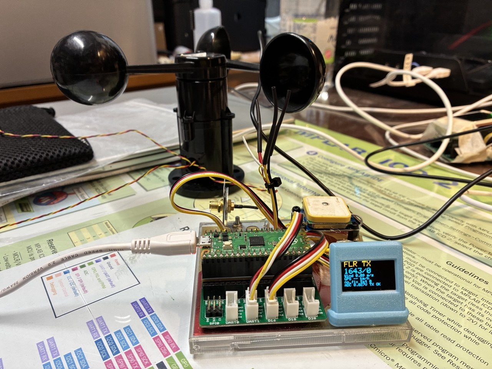
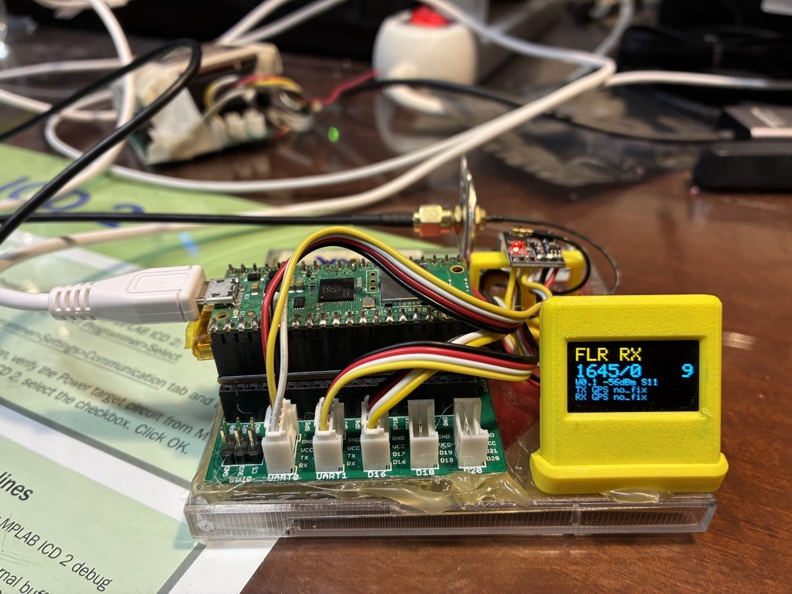
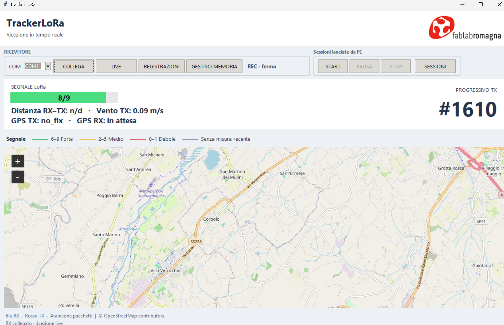
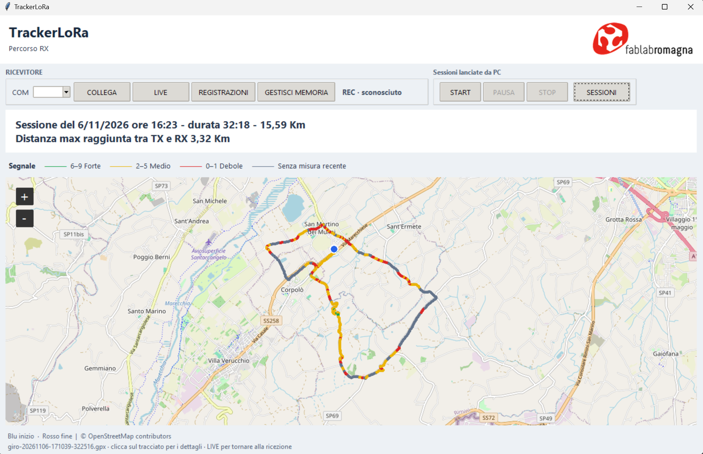

# FLRLoRaTracker


Un sistema LoRa per misurare il vento, seguire le posizioni GPS e verificare la qualità del collegamento sul territorio. Due Raspberry Pi Pico costituiscono il trasmettitore TX e il ricevitore RX. Un client Python sul portatile mostra la ricezione e i percorsi su OpenStreetMap.

Il TX acquisisce l'anemometro e trasmette vento, tensione, posizione GPS e numero progressivo. L'RX visualizza i dati e registra le sessioni nella memoria interna tramite un pulsante. Dal client si possono scaricare e rivedere i percorsi, leggere distanza e segnale, e gestire lo spazio sul Pico.

## Guide

- [Firmware, configurazione TX/RX e collegamenti elettrici](Tracker/README.md)
- [Client Python, mappe, registrazioni e gestione memoria](Client/README.md)

## TX e RX

| Trasmettitore con anemometro | Ricevitore |
| --- | --- |
|  |  |

## Ricezione live

Segnale da 0 a 9, vento TX, distanza RX–TX e progressivo leggibili durante la ricezione. La mappa segue la posizione del ricevitore.



## Sessioni sulla mappa

Il tracciato si colora in base al segnale ricevuto. Il riepilogo mostra data, durata, lunghezza del percorso e massima distanza RX–TX disponibile. Le registrazioni si consultano direttamente nella mappa del client.



## Struttura

| Cartella | Contenuto |
| --- | --- |
| [Tracker](Tracker/) | Firmware Arduino per TX, RX e RX con anemometro di taratura |
| [Client](Client/) | Client desktop Python e relativa documentazione |
| [FLRNemo](FLRNemo/) | Prove CircuitPython per lettura anemometro e display ST7735R |
| [images](images/) | Logo, foto dei dispositivi e schermate del client |

## Avvio del client

Dalla cartella principale, con Python per Windows e Tkinter installati.

```powershell
cd Client
py -m pip install -r requirements.txt
py tracker_client.py
```

Collega l'RX via USB, seleziona la sua COM e premi **COLLEGA**. Per configurare i dispositivi e registrare il primo giro segui le guide dedicate.

## Licenza

GNU AGPL-3.0. Il testo completo è nel file [LICENSE](LICENSE).
